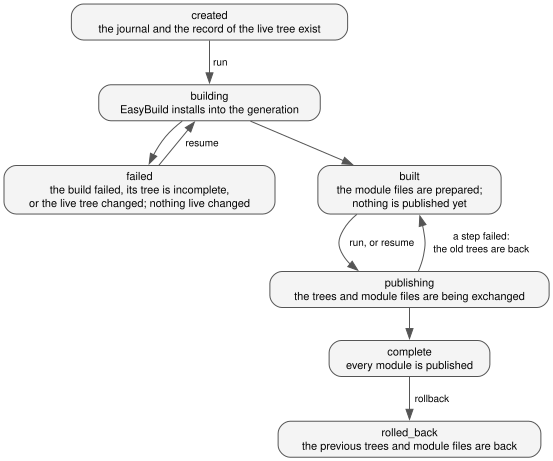

#+TITLE: What the journal records
#+OPTIONS: toc:nil todo:nil num:nil author:nil title:nil
#+STARTUP: content

* What the journal records

How does a run that failed, or a machine that went down in the middle of one, leave something to finish or to undo?

** The problem

A run takes as long as its build, and changes several things on the way: a generation, a hidden tree, directories, module files, links, ledger records.
A build can fail, a node can lose power, and an operator can stop a run that takes too long.
Whoever comes next has to know what the run had done, which of two trees is the new one, and what is safe to do now, without reading the code.

** How eb-staged-rebuild handles it

*** One journal per run

Each run writes =<state-root>/runs/RUN_ID/journal.json=, and replaces the whole file after each step, by a rename in the same directory, so a reader always finds a complete journal.
The run id is the one =--run-id= gives, which must not be taken already, or else the time the run started, in UTC, and the number of its process, =YYYYMMDD-HHMMSS-PID=, with =-1=, =-2= and so on added while that name is taken.
The journal holds what the run was given and what it found: the trees, the backend, the EasyBuild command, the grace period that =gc= keeps the previous tree for, the probes, the record of the live tree, with =bwrap= the mount points to remove after the build, the ledger configuration; and, for each module file, the stable directory, the new tree and its hidden name, the backup, the SHA-256 of the old and new module file, and how far its publication got.
=gc= records =retired_removed_at= when it removes a hidden tree and =generation_removed_at= when every hidden tree is settled and it removes the run's generation.
A later =resume= that rebuilds the run recreates the generation and clears =generation_removed_at=.
=status= prints the journal of every run, or of one; [[file:../reference/files.org][Files]] lists what is in it.

*** The states

#+CAPTION: The states of a run's journal, and the commands that move it on.
#+ATTR_RST: :alt A run creates the journal, then builds. A build that failed, an incomplete tree or a changed live tree make the run failed, and resume builds again. A successful build makes it built, with the module files prepared; run or resume then publish. A failed step of the publication puts the old trees back and the run is built again; otherwise it is complete. rollback of a complete run makes it rolled_back

What =resume= does follows from the state:

| State                           | =resume=                                                                               |
|---------------------------------+----------------------------------------------------------------------------------------|
| =created=, =building=, =failed= | builds the generation again, as long as no module of the run is published              |
| =built=, =publishing=           | puts every module back to the old tree, then publishes again                           |
| =complete=                      | delivers ledger records that are still pending, and otherwise says the run is complete |
| =rolled_back=                   | refuses: start a new run                                                               |

A run that a preparation program, directory preparation, or a pending ledger record stopped stays =built=, and =resume= runs that step again.
The state changes to =publishing= only after every directory is ready for the swap.
[[py:eb_staged_rebuild.engine.resume]] and [[zig:eb-staged-rebuild.engine.run_mod.resumeRun]] decide.

*** Which tree is which

After a crash in the middle of an exchange, the journal alone cannot say whether the call happened.
The trees say it: before a run publishes, it writes =.eb-staged-rebuild-complete= into its new tree, with its run id, and the hidden name of that tree has the run id too.
=resume= reads the stamps of the two trees, at the stable path and at the hidden name, and finds the new one; a pair it cannot tell apart, such as two trees with the run's stamp, is left to the operator, with =cannot identify old and staged trees=.
After the three renames that replace an exchange on some filesystems, the hold name =.VERSION.RUN_ID.fallback-old= is what tells =resume= to put the names back first.

*** Retire records

=retire= writes a journal of its own, under =runs/retire-STAMP/=, with =kind= set to =retire=, before it moves the module file and after: =retiring=, then =retired=, then =rolled_back= once a rollback puts the file back.
Its =links_plan= records every discovered symbolic link to the module file, including the live and retired paths, the link text and whether it is pending, retired or restored.

** What was considered and turned down

- /Applying a journal of the generation-pointer design./
  Its plan points module files at generations instead of exchanging directories, which this program does not do, so schemas 1 and 3 are refused rather than half applied.
- /Listing the readable journals when one is not./
  =status= stops at the first journal it cannot read: a list without it would hide the run that needs attention.

** Limits

- The journal is only as reachable as the state root: put the state root on the filesystem of the software tree, where the run has to be able to rename anyway.
- A crash while the run prepares its module files can leave prepared files behind while the journal still says =building=; =resume= builds that generation again.
** Further reading

- [[file:../howto/recover.org][Finish a run that failed or stopped]] continues a failed run.
- [[file:publication.org][How a rebuild is published]] covers the steps the states stand for.
- [[file:locking.org][How runs keep out of each other's way]] covers the lock that the journal is written under.
- [[file:../reference/files.org][Files]] lists the files of the state root.
