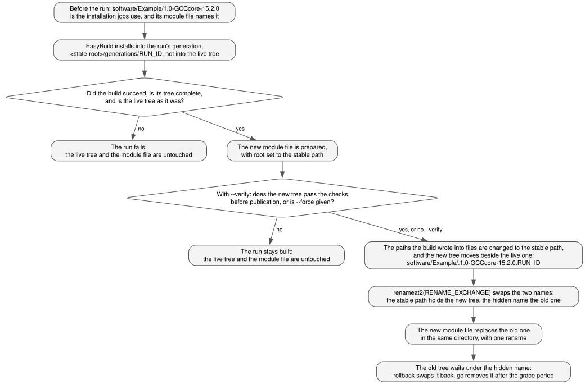

#+TITLE: Why a rebuild is staged and swapped in
#+OPTIONS: toc:nil todo:nil num:nil author:nil title:nil
#+STARTUP: content

* Why a rebuild is staged and swapped in

Why does eb-staged-rebuild build a second copy of an installation and exchange it with the first, instead of rebuilding it where it is?

** The problem

EasyBuild installs a package once, at =software/NAME/VERSION=, and the module file it writes names that directory.
Jobs load the module and read files under that path for as long as they run, and other installations name it too: in the RPATH of their binaries, in pkg-config files, and in the modules they load.
To rebuild a package, after a fix to its easyconfig or to repair a damaged file, =eb --rebuild= or =--force= first empties the installation directory, then builds, installs, and runs the sanity check at the end.
For the length of the build the path holds a partial installation, or none: a job that starts then cannot find its files, a running job fails on the next file it opens, and a build that fails leaves nothing to go back to.

** How eb-staged-rebuild handles it

eb-staged-rebuild never gives EasyBuild the live directory.
Each run has a /generation/, =<state-root>/generations/RUN_ID=, and EasyBuild installs into it; [[file:isolation.org][How a build is kept off the live tree]] says how each backend sees to that.
The live tree is replaced only once the new one is complete:

#+CAPTION: One run, from the build to the removal of the old tree.
#+ATTR_RST: :alt Before the run the stable path is the installation jobs use. EasyBuild installs into the run's generation. If the build failed, the tree is incomplete or the live tree changed, the run fails and nothing live changes. Otherwise the new module file is prepared with root set to the stable path. With --verify, if the new tree fails the checks before publication and --force is not given, the run stays built and nothing live changes. Otherwise paths the build wrote into files are changed to the stable path, and the new tree moves beside the live one under a hidden name; renameat2 with RENAME_EXCHANGE swaps the two names; the new module file replaces the old one with one rename; the old tree waits under the hidden name until rollback swaps it back or gc removes it after the grace period

*** A complete tree, or nothing

Before the run builds, it records the live installation: the inode, size and SHA-256 of every file, and the target of every symbolic link.
After the build, the run goes on only if EasyBuild exited 0, if the new installation directory holds what a finished build leaves, the easyconfig that EasyBuild copies into =easybuild/= at the end, and if the live tree still matches the record.
Before that comparison, the run requires one well-formed record for every module relation in its journal; a damaged record needs operator intervention and leaves the live tree in place.
Otherwise the run is =failed=, and the live tree and its module file are as they were; [[file:../howto/recover.org][Finish a run that failed or stopped]] continues from there.
=--skip-live-check= drops the record and its check.
A complete tree can still be one that jobs cannot use, so with =--verify=, before it publishes, the run also checks that the libraries of its programs are found, that no file names the build directory or a temporary directory, that Lmod loads its module file and that publishing would not change who may use it; [[file:../howto/verify-a-stage.org][Check a rebuild before it goes live]] covers a tree that fails.

*** One name for the installation

The new tree is published under the name the old one had, =software/NAME/VERSION=, so that every path that names the installation stays right: the module file, the RPATH of the packages built against it, and the paths in its own files.
The module file the run publishes is the one EasyBuild wrote for the generation, with its =root= set to that stable path.
With the =installpath= and =userns= backends, EasyBuild also wrote the generation's path into RPATH entries, scripts and other files of the tree; before the exchange, the run replaces it with the stable path in each file.
In a binary the stable path has to fit in the room of the generation's: a C string is shortened in place, so the bytes after it stay where they are.
With =bwrap= nothing needs changing, because EasyBuild saw the stable path inside the sandbox.

*** One rename to switch

The new tree first moves beside the live one, as =software/NAME/.VERSION.RUN_ID=.
A directory can be renamed only within one filesystem, so this move is the step that needs the state root and the software tree on the same one.
Then =renameat2= with the =RENAME_EXCHANGE= flag swaps the two names in one call: at every moment =software/NAME/VERSION= is a complete installation, the old one before the call and the new one after it.
Last, the new module file replaces the old one with a rename in the same directory, so a reader gets one of the two whole files.
[[file:publication.org][How a rebuild is published]] covers the case of several module files, and filesystems that cannot exchange.

*** The old tree waits

A process that has a file of the old tree open keeps reading the old file after the exchange, from under the hidden name.
On a network filesystem such as NFS, a file deleted on one machine can be gone for a process that has it open on another, so the old tree stays until the longest job could have finished: the /grace period/, 144 hours unless the site sets its own.
Until =gc= removes it, =rollback= exchanges it back.
=list= prints the trees kept beside each installation and the run that published each; [[file:../reference/generations.org][The generations of an installation]] describes its output.

The run's id in the hidden name, and in the completion stamp =.eb-staged-rebuild-complete= that the run writes into its new tree, is how a resumed run tells the new tree from the old one; [[file:journal.org][What the journal records]] has the rest.
[[py:eb_staged_rebuild.engine.run]] and [[zig:eb-staged-rebuild.engine.run]] run all of this in the two builds.

** What was considered and turned down

- /Rebuilding in place with =--rebuild=./
  It empties the directory before the new build has passed its checks.
- /A module file that points at the new generation./
  The module file would name a new path on every rebuild, while the packages built against the old path keep naming it in their RPATH and their modules.
  The tool refuses journals of that design, schemas 1 and 3.
- /Copying the new files over the old ones./
  For the length of the copy, and after a copy that stopped, the directory holds a mix of the two builds.
- /Removing the old tree at once./
  It takes away the way back, and on a network filesystem it can take files from under running jobs.

** Limits

- The exchange is one call for one directory: a process that opens one file before it and another after it can mix the two builds.
- A run that publishes several module directories exchanges them one after the other; the set as a whole does not change in one step.
- A filesystem without =RENAME_EXCHANGE= gets three renames instead, and a moment in which the stable path is missing; a run killed in that moment leaves it missing until =resume= puts the names back.
- The installation must exist already, as a real directory: the tool rebuilds, it does not make a first installation.
- The old tree takes the space of a second installation until =gc= removes it.
- =gc= does not look for open files, on this machine or any other: only the grace period keeps a tree that jobs still use.
- A binary whose generation path is shorter than the stable path cannot be changed, and the run fails; that happens with a state root whose path is much shorter than the software tree's.

** Further reading

- [[file:../tutorials/first-staged-rebuild.org][Rebuild an installation and put the old one back]] shows one run and its rollback.
- [[file:publication.org][How a rebuild is published]] covers the exchange, the module files and the rollback in detail.
- [[file:journal.org][What the journal records]] covers the journal, and how a run continues after a crash.
- [[https://github.com/stackhands/eb-staged-rebuild/blob/main/DESIGN.md][DESIGN.md]] is the maintainers' record of the design and of what was rejected.
